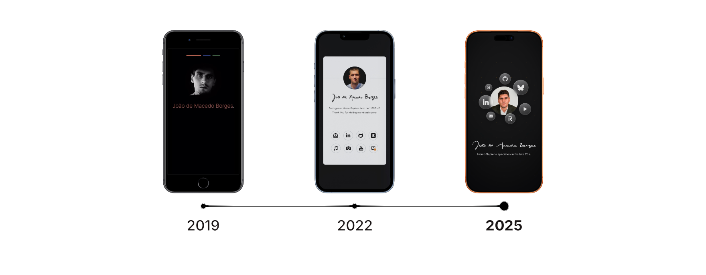

## 🎨 Design Evolution

## 🍀 Contributors
This project got a lot of love and support from [Mário Matias](https://www.linkedin.com/in/jmamatias), [Francisco Araújo](https://www.linkedin.com/in/franciscoeparaujo), [Miguel Martins](https://instagram.com/miguelmartinsmm), [Mariana Preto](https://www.linkedin.com/in/mariana-preto), [Pedro Mouta](https://www.linkedin.com/in/pedro-mouta-52080124a) and [Ana Júlia Torres](https://www.linkedin.com/in/ana-júlia-torres-7b7b0130a/).

## 🔌 Service Status
You can always check if everything is up and running at [status.jbbmb.com](http://status.jbbmb.com).

## 🫆 Privacy Policy
jbbmb.com itself does not use cookies or track You through browser storage mechanisms.

This website uses [GoatCounter](https://www.goatcounter.com), a privacy-friendly, open-source analytics service, to collect anonymous usage statistics. The information recorded may include the page visited, the website that referred You, Your browser and operating system, Your screen size, Your approximate geographic location, and which of the links on the page are clicked. Your IP address is not stored: a hash of it, combined with Your User-Agent and a random value, is kept in memory for up to eight hours only to tell visits apart and is never written to disk. Nothing is stored in Your browser, and no data is shared with third parties. If JavaScript is disabled, a tiny tracking image records the page view only. GoatCounter's own policy is available at [goatcounter.com/privacy](https://www.goatcounter.com/privacy).
 
The legal basis for processing this data is João's legitimate interest in understanding traffic patterns and improving user experience. No Personally Identifiable Information is intentionally collected, stored, or shared.
 
Under the General Data Protection Regulation, You have the right to request access to, or deletion of, any data associated with Your session. Although this data is anonymous and not directly linked to individuals, requests will be honored to the fullest extent possible. To initiate such a request, please contact João directly via e-mail.
 
João reserves the right to update this policy at any time. Continued use of the website constitutes acceptance of any changes. Please review this policy periodically to stay informed.

## 📌 Copyright

All rights reserved unless otherwise stated. This website incorporates original work created by João de Macedo Borges and select open-source or public resources used in compliance with their respective licenses:
* Inter Typeface, designed by Rasmus Andersson and used under the MIT License.
* Background Animation, adapted from the public CodePen of @jp-arts and used non-commercially.
* Text Scramble Animation, inspired by the public CodePen of @soulwire and used non-commercially.
* Liquid Glass Effect, adapted from publicly available code on Snipzy and used non-commercially.
* SF Compact Iconography, from the Apple Native CoreSVG 326 system and used for non-commercial purposes. All rights belong to Apple Incorporated.

Where applicable, code snippets and components may fall under Creative Commons Attribution 3.0 if not otherwise licensed.

All other content, source code, design, and assets not explicitly attributed are © João de Macedo Borges and may not be copied, reproduced, modified, or redistributed without prior permission.

This website is provided "as is" without any warranties. No liability is accepted for any loss or damages arising from its use.

###### 🤖 Built with help from Claude, by Anthropic.